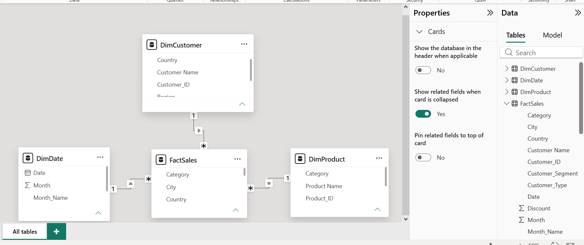

# Project Screenshots

This folder contains screenshots documenting the development and analysis of the **Retail Sales & Customer Performance Analysis** project.

## 1. Python Data Analysis

* Dataset loading and exploration
* Data cleaning and validation
* Feature engineering
* Sales and profit analysis
* Customer analysis and visualizations

## 2. SQL Analysis

* Total sales and profit calculations
* Sales analysis by category
* Top 10 customers by sales
* SQL queries and results

## 3. Power BI Dashboard

* Data model and table relationships
* Sales performance KPIs
* Customer analysis and rankings
* Product and category performance
* Interactive filters and visualizations

### Power BI Data Model and Relationships

**Power BI File:** `Retail_Sales_Relation.pbix`

The data model shows the tables and relationships used in the Retail Sales & Customer Performance Analysis project.

## Screenshot Organization

The project screenshots are organized by analysis stage for easy navigation.

* **Python Analysis:** Dataset preview, data cleaning, feature engineering, and exploratory data analysis.
* **SQL Analysis:** SQL queries, sales calculations, customer analysis, and query results.
* **Power BI:** Data model relationships, dashboard visuals, customer insights, and product performance.

This structure helps readers follow the project workflow from data preparation to business insights and visualization.

## Project Status

The Retail Sales & Customer Performance Analysis project includes Python-based data cleaning and analysis, SQL queries, and an interactive Power BI dashboard.

The project covers sales performance, profitability, customer purchasing behavior, product performance, and business recommendations. Project documentation and presentation materials are also being prepared for final submission.

